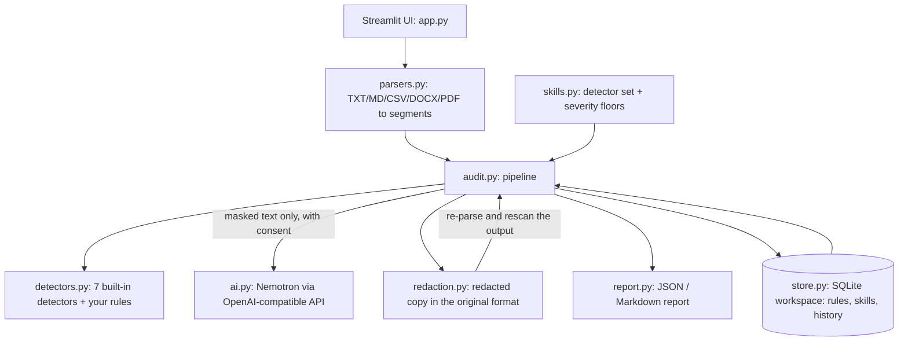

# ShareSentry

**Check a document before you share it.** ShareSentry finds sensitive information in files you are about to send to a client or publish, explains the risk, produces a redacted copy, and gives you evidence of what it did. A Nemotron model adds context-aware review on top of deterministic checks, but it is never the sole authority: the tool will never call a document "safe".

Built for the NVIDIA x Nebius hackathon. Target users: freelancers, independent developers and small teams who share proposals, CSV exports and release notes.

## How it works



1. **Parse.** Each format becomes addressable segments (a CSV cell, a DOCX paragraph, a PDF page, or whole text), so redaction can preserve structure.
2. **Detect (deterministic).** Email, phone (always labelled *uncertain*), credit card (Luhn-validated), API keys and tokens, PEM private keys, AWS access keys, internal/confidential markings, plus your own rules. Every finding has exact offsets.
3. **Apply the skill and context.** A skill chooses which detectors run and raises severities (for example Public Release Review treats any email as High). An *internal team* context relaxes labels and terms by one level; secrets are never relaxed.
4. **Optional AI review (consent required).** A masked copy is sent in one bounded request. The model can annotate findings and add concerns, but each concern must quote text that really exists in the document, it cannot raise a Critical, and it can never remove a finding or lower the status.
5. **Redact and verify.** Pick findings to redact, get a copy in the original format, then ShareSentry **re-parses the produced file and rescans it**; the report states how many findings remain.

### Status values

| Status | Meaning |
|---|---|
| Action required | At least one High or Critical finding |
| Review recommended | Only Low or Medium findings |
| No issues detected within scope | Nothing found by the checks that ran. Not a guarantee |
| Incomplete | Part of the document could not be inspected (scanned PDF page, unsupported or corrupt file) and nothing else was found |

### Skills

| Skill | What it changes |
|---|---|
| Client-Ready Review | All detectors; email and phone at least Medium; labels and your terms at least High |
| Secrets & Credentials Scan | Only credentials and card numbers, all raised to Critical |
| Public Release Review | All detectors; contact data, labels and terms High; cards Critical |
| CSV Data Minimizer | Per-column finding summary and an option to drop whole columns from the copy |

Skills can be switched on or off per workspace.

## Quick start

Tested on Python 3.12.

```bash
python -m venv .venv && source .venv/bin/activate      # Windows: .venv\Scripts\activate
pip install -r requirements.txt
cp .env.example .env                                    # then edit AI_PROVIDER and AI_API_KEY
streamlit run app.py
```

Without an API key everything except the AI review works. Create a workspace on the login screen, then use **Run on synthetic sample** on the Audit page for an instant demo (all values are fake).

### AI providers

All providers use the same OpenAI-compatible protocol; pick one with `AI_PROVIDER`.

| `AI_PROVIDER` | Endpoint | Default model | Nemotron? |
|---|---|---|---|
| `nvidia` (default) | `https://integrate.api.nvidia.com/v1` | `nvidia/nemotron-3-super-120b-a12b` | Yes (Nemotron Super) |
| `nebius` | `https://api.tokenfactory.nebius.com/v1` | `nvidia/Nemotron-3-Ultra` | Yes (confirm the exact ID in your Nebius console) |
| `groq` | `https://api.groq.com/openai/v1` | `openai/gpt-oss-120b` | **No.** Groq's model catalog has no Nemotron model |
| `custom` | your `AI_BASE_URL` | your `AI_MODEL` | depends |

Model catalogs change. **Settings → Test connection** lists what your endpoint serves and tells you whether the configured model ID exists. The app warns whenever the model is not a Nemotron model, and every report records the model that was actually used.

## Privacy model

- Documents are parsed in memory and never written to disk. History stores **masked excerpts and counts only**.
- AI requests contain masked text, finding categories and policy names. Detected values and your rule terms are never sent.
- The workspace passphrase is stored as a salted scrypt hash. **The SQLite file is not encrypted at rest**, and rule terms are stored in plain text; protect the `data/` folder accordingly.
- Backups (Rules & Memory page) contain rules, skill settings and history; never the passphrase, API key or documents. You can leave rule terms out of a backup.
- Deleting a workspace removes its database file.

## Tests

```bash
pip install -r requirements-dev.txt
python -m pytest -q          # or: python -m unittest discover -s tests -t .
```

102 tests cover every detector, skills, parsers (including corrupt and scanned files), redaction round-trips for all five formats with rescan verification, AI gating and response validation (including a real local HTTP server), the SQLite store, reports, configuration, and a scripted run of every Streamlit page.

## Known limitations

- Detection is pattern-based. Names, addresses, free-text secrets and business context are covered only by your own rules and the optional AI review.
- Phone matches are format-based and always marked uncertain.
- DOCX: comments, tracked changes, embedded objects, hyperlink targets and metadata are not inspected; author and last-modified-by are cleared in redacted copies.
- PDF: only text layers are inspected; image-only pages make the audit *Incomplete*. A redacted PDF is rebuilt as plain text, so layout and images are not preserved.
- AI review sees at most `AI_MAX_INPUT_CHARS` characters; truncation is disclosed in the report.

## Project layout

```
app.py                    Streamlit UI
sharesentry/
  models.py  config.py    types and environment configuration
  detectors.py skills.py  detection and audit workflows
  parsers.py redaction.py file formats in and out
  ai.py                   Nemotron review (OpenAI-compatible, stdlib HTTP)
  audit.py report.py      pipeline, status logic, reports
  store.py                persistent workspace (SQLite + scrypt)
  sample.py               synthetic demo data
sample_data/              fake text and CSV used by the demo
tests/                    102 tests
```

MIT licensed. See [LICENSE](LICENSE).
